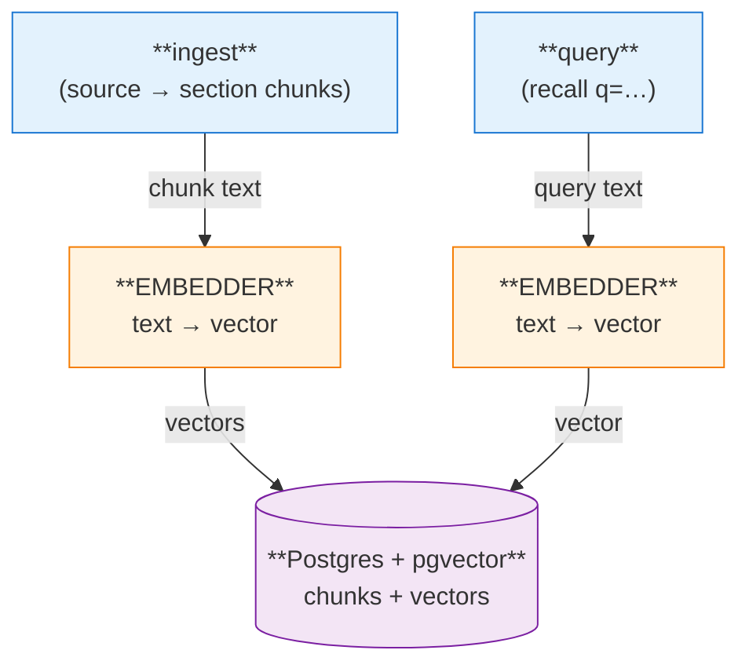

# Embedder

How brainbot turns text into vectors, what it runs today, why, and how to swap the model.

## What the embedder does

Two call sites, one provider:

1. **Ingest.** Each source's text is split into section chunks; the embedder vectorizes every chunk (one batched call — `brain/brain/embed.py`). The vectors are stored in `chunks.embedding` (`vector(512)`) in Postgres + pgvector.
2. **Query.** `recall` embeds the query string so the semantic arm (cosine `<=>` over the HNSW index) can find related chunks; the lexical `tsvector` arm needs no embedding.



## Current default: local Ollama (`embeddinggemma`, 768-dim)

The `ollama` compose service runs the model on the box (CPU, ~600 MB of RAM held
loaded); the brain calls its `/api/embed` over brainnet. Nothing leaves the host —
not chunk text at ingest, not query text at recall. Configured with
`BRAIN_EMBED_MODEL` + `BRAIN_EMBED_DIM` (and `BRAIN_EMBED_URL`); the column dim
(`EMBED_DIM`) must match the model. `brain/embed.py` adds each model's documented
query/document prefixes (retrieval models embed the two sides asymmetrically).

Privacy escape hatch for the Claude Code hook: set `BRAIN_INJECT_DISABLE=1` to skip it entirely (no query embedding, no injection).

## If the embedder is down

`recall` degrades to the lexical arm alone (with a logged warning) instead of
failing — consumers get keyword matches, not a 502. Ingest still fails loud: a
chunk must never be stored without its vector.

## Changing the model

1. Pull nothing by hand — set `BRAIN_EMBED_MODEL` / `BRAIN_EMBED_DIM` in
   `compose/.env`; the `ollama` service pulls the model on start.
2. Re-embed the corpus with the brain stopped (it refuses to boot while the stored
   vectors' dim differs from `EMBED_DIM`):

   ```sh
   docker compose stop brain
   docker compose up -d ollama            # pulls the new model, turns healthy
   docker compose run --rm brain python -m brain.reembed
   docker compose up -d brain
   ```

   `brain.reembed` embeds everything first, then swaps the column in one
   transaction — a failure leaves the old vectors intact. ~2 min for ~750 chunks
   on 2 vCPUs with `embeddinggemma`.
3. Before switching, measure it: `brain/eval/README.md` → "Embedder A/B".

## Why `embeddinggemma` (eval, 2026-10-20)

Measured with `brain/eval/embedder_ab.py` over 88 probes (8 legacy + 80 generated
from 40 real sources; half are paraphrases that avoid the source's words), each
model on its own re-embedded copy of the 755-chunk corpus. Source-level recall@5
and MRR (hybrid = what consumers get; semantic-only scored identically, since
`plainto_tsquery` rarely matches full-sentence queries). Query latency on the
2-vCPU VPS; Voyage's includes the network hop.

| Embedder | dim | R@5 all | MRR all | R@5 paraphrase | MRR paraphrase | query p50 | re-embed 755 chunks |
|---|---|---|---|---|---|---|---|
| voyage-3-lite (previous, API) | 512 | 0.886 | 0.752 | 0.825 | 0.579 | 112 ms | — |
| **embeddinggemma** | 768 | **0.886** | **0.807** | **0.825** | **0.693** | **59 ms** | 114 s |
| qwen3-embedding:0.6b | 1024 | 0.875 | 0.772 | 0.775 | 0.640 | 410 ms | 535 s |
| mxbai-embed-large | 1024 | 0.864 | 0.748 | 0.800 | 0.630 | 173 ms | 314 s |
| nomic-embed-text | 768 | 0.761 | 0.672 | 0.600 | 0.462 | 63 ms | 123 s |

`embeddinggemma` ties Voyage on recall, ranks the right source higher (MRR +0.055
overall, +0.11 on paraphrases), and halves query latency — while dropping the
external hop, the API key, and the account. The larger models are slower without
being better on this corpus; `nomic-embed-text` (the earlier plan's pick) is
clearly worse on paraphrased queries.

Voyage was the original default because it optimized for "stand it up in an
afternoon" (one env var). In practice its network hop occasionally dropped
(`RemoteDisconnected`), and with no lexical fallback each drop was a 502 to scout.

## Alternative: no embedder at all

Drop the semantic arm; recall becomes pure full-text (`tsvector` BM25-style). Nothing to run, but fuzzy queries ("what places does the user like to work from") only match on shared words — and with `plainto_tsquery` ANDing every word, long natural-language queries rarely match at all.
